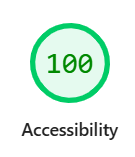

# יועץ הרכב של שטראוס

בוט בעברית שעונה לעובד תוך דקה: מה יקרה לנטו שלי אם אעבור לרכב חשמלי, לרכב אחר, למסלול ברוכת ילדים, או אוותר על הרכב?

הבוט משווה ולא ממליץ. כל מספר מחושב בקוד, אף פעם לא במודל השפה. מידע חסר נשאל מהעובד, ומידע של החברה עובר לנציג התחבורה.

> האקתון AI קוד פתוח 2026.

## שימוש

לא צריך להתקין כלום. פותחים את האתר בדפדפן, במחשב או בטלפון:

- **עובד:** https://strauss-car-advisor.netlify.app – מקלידים קוד כניסה, וכותבים לכובי.
- **נציג התחבורה:** https://strauss-car-advisor.netlify.app/rep – סיסמת הנציג.

קודי הכניסה והסיסמה נמסרים בנפרד, ולא נשמרים בגיט. אחרי זמן בלי שימוש השרת החינמי נרדם, ולכן התשובה הראשונה עשויה לקחת כחצי דקה.

## נגישות

האתר נבדק והותאם ככל הניתן לפי WCAG 2.1 ברמה AA (ת"י 5568). הצהרת הנגישות נמצאת ב-[/accessibility](https://strauss-car-advisor.netlify.app/accessibility).

- **בכל הרצה של הבדיקות:** `axe-core` בודק כל מסך ברוחב 375 וברוחב 1280 (`frontend/src/a11y.test.jsx`). כל ממצא, בכל רמה, מכשיל את הבדיקה. הניגודיות נבדקת במצב בהיר ובמצב כהה.
- **Lighthouse ב-Chrome, 21/10/2026:**

  | מסך | תוצאת Accessibility |
  |---|---|
  | מסך הפתיחה | 100 |
  | הצ'אט | 25/25 בדיקות עברו (מצב Snapshot) |

  

- **מה זה לא אומר:** בדיקה אוטומטית מוצאת רק חלק מבעיות הנגישות, כמו ש-Lighthouse עצמו כותב. היא לא מבטיחה שהאתר נגיש. קורא מסך אמיתי לא נבדק בכל המכשירים. בכרטיסי ההשוואה הקריאה בקורא מסך ארוכה, ולסרטון הפתיחה (בלי דיבור) אין כתוביות. אפליקציית הטלפון (`phonefrontend/`) לא נבדקה.

## הפעלה מקומית (למפתחים)

דרוש Python 3.12.

```bash
cd backend
python -m venv .venv
.venv/Scripts/python -m pip install -r requirements.txt   # ב-Linux/Mac: .venv/bin/python
```

### בדיקות

```bash
cd backend
.venv/Scripts/python -m pytest -q
```

הבדיקות לא צריכות מפתחות. המודל מוחלף במודל מזויף, ומספרי הייחוס נקראים מגיליון "חישובים" ב-`backend/data/strauss-data.xlsx`.

### שיחה בקונסול

1. מעתיקים את `backend/.env.example` ל-`backend/.env`, וממלאים לפחות `GOOGLE_API_KEY`.
2. מריצים:

```bash
cd backend
.venv/Scripts/python -m app.agent.chat
```

כותבים בתור העובד. פקודות הנציג:

| פקודה | מה היא עושה |
|---|---|
| `/rep` | מציגה שאלות פתוחות לנציג |
| `/rep 1 carGroup=ב companyCost=3500 participation=250` | עונה על שאלה 1, והבוט מחשב מחדש |
| `/card` | מציגה את כרטיס ההשוואה האחרון |
| `/exit` | יציאה |

## החלטות ארכיטקטורה

שרטוטים של השכבות, של המסלול של שאלה ושל מסלול הנציג: [docs/architecture.md](docs/architecture.md)

### מסד נתונים: Neon, ועדכונים ב-SSE מהשרת
- **הצורך:** כשהנציג עונה, החלופה מתעדכנת אצל העובד מיד, בלי לרענן את הדף.
- **Neon:** Postgres נקי (`DATABASE_URL`). בלי `DATABASE_URL` הכול בזיכרון, לפיתוח ולבדיקות.
- **זמן אמת:** זרם SSE מהשרת שלנו (`GET /conversations/{id}/events`). המסד הוא מקור האמת, וה-SSE רק מצלצל: תשובת הנציג נשמרת קודם, ואז יוצא אירוע `changed` בלי נתונים, והדפדפן קורא את המצב מהשרת. הדפדפן קורא את המצב גם בטעינה, בחזרה ללשונית ואחרי חיבור מחדש.
- **תהליך אחד:** רשימת המחוברים נשמרת בזיכרון של התהליך, ולכן השרת רץ עם `--workers 1` (`render.yaml`).
- **`/health` לא פונה למסד:** UptimeRobot מעיר רק את Render. Neon מתעורר לבד, ופנייה קבועה הייתה מונעת ממנו להיכבות ושורפת את מכסת החינם.
- **מתי נשנה:** יותר מתהליך אחד דורש מנגנון משותף (למשל LISTEN/NOTIFY), ו-Neon בתשלום.
