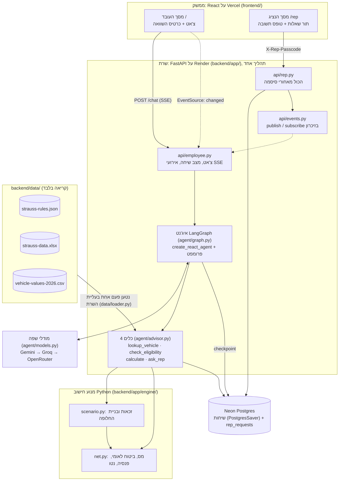
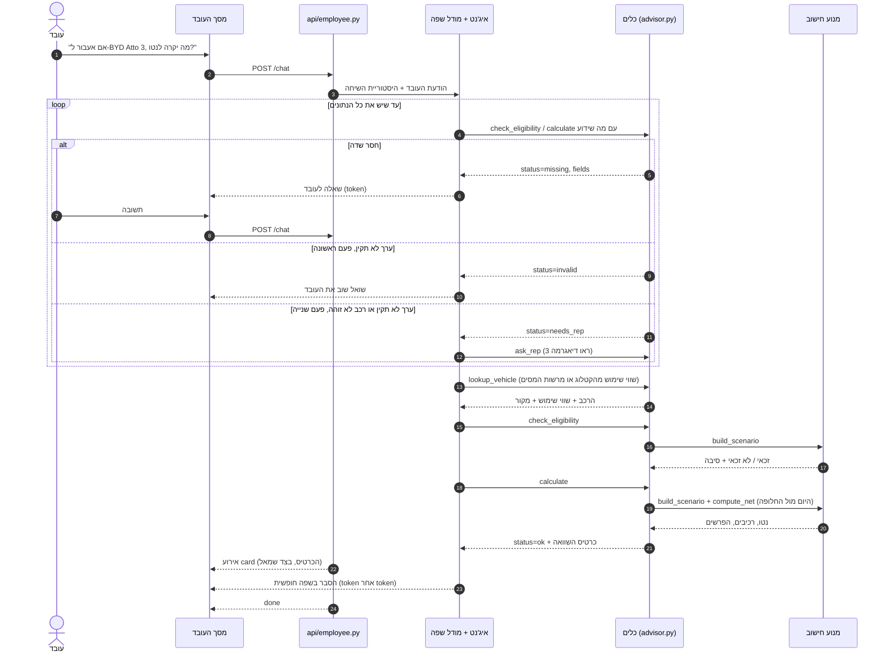
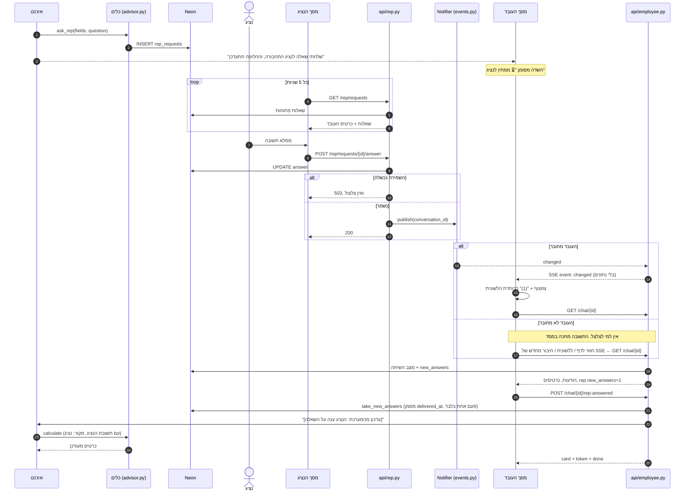

# ארכיטקטורה

שלוש דיאגרמות: השכבות, המסלול של שאלה, ומסלול הנציג. הן מתארות את הקוד כמו שהוא היום.
ההחלטות וההקשר: [CLAUDE.md](../CLAUDE.md).

## 1. שכבות

| שכבה | מה היא עושה | מה היא לא עושה |
|---|---|---|
| ממשק (React) | מציג את השיחה ואת הכרטיס, ומעצב מספרים לתצוגה | לא מחשב. ההפרשים מגיעים מוכנים מהשרת |
| איג'נט + מודל שפה | מחליט מה לשאול ואיזה כלי להפעיל, ומנסח בעברית | לא מחשב ולא כותב למסד. כל מספר מועתק מתוצאת כלי, וזה נאכף בפרומפט בלבד |
| כלים (`advisor.py`) | בודקים שהקלט שלם ותקין, מחזירים "חסר" או "צריך נציג" במקום לנחש, ושומרים שאלות לנציג | לא מנסחים טקסט לעובד, ולא קוראים למודל |
| מנוע חישוב | חישוב טהור של זכאות ונטו, לפי הכללים מהקובץ | לא יודע על מודל, שיחה או מסד |
| נתונים | כללים, קטלוג, עיסוקים, שווי שימוש | קריאה בלבד. הקוד לא משנה אותם |
| Neon | שומר את השיחות ואת תור הנציג, ומשמש מקור האמת | לא נבדק ב-`/health`, כדי ש-Neon יוכל להיכבות |

השרת רץ בתהליך אחד, כי רשימת הדפדפנים שמחוברים ל-SSE נשמרת בזיכרון של התהליך.
קבצי הנתונים נטענים לזיכרון פעם אחת בעליית השרת. אם הכללים לא תואמים לקטלוג, השרת לא עולה.

## 2. המסלול של שאלה

המודל מחליט על סדר הקריאות. הסדר שבדיאגרמה הוא הסדר הרגיל, לא סדר שהקוד אוכף. `calculate` מזהה את הרכב בעצמו, גם בלי קריאה קודמת ל-`lookup_vehicle`.
ניסיונות כושלים נספרים מתוך תוצאות הכלים הקודמות בשיחה, ולכן הכלים עצמם בלי מצב. הספירה חלה על ערך לא תקין ועל רכב שלא זוהה. שדה שפשוט חסר נשאל שוב ושוב, ולא עובר לנציג.
כשכל מודלי השפה נכשלים, השרת שולח אירוע `error` עם "המערכת עמוסה". מה שכבר נכתב לעובד נשאר על המסך.

## 3. מסלול הנציג

המסד הוא מקור האמת, וה-SSE רק מצלצל: האירוע `changed` לא נושא נתונים, והדפדפן קורא את המצב מהשרת. הצלצול מגיע רק לדפדפנים שמחוברים לאותה שיחה.
עובד שלא היה מחובר מקבל את התשובה כשהוא חוזר, כי הדף קורא את השיחה מהמסד בטעינה, בחזרה ללשונית ואחרי חיבור מחדש. במקרה הזה אין צפצוף.
הבוט מחשב מחדש פעם אחת לכל תשובת נציג (`delivered_at`), גם אם פתוחות שתי לשוניות. מסך הנציג עצמו לא משתמש ב-SSE: הוא בודק אם יש שאלות חדשות כל 5 שניות.
